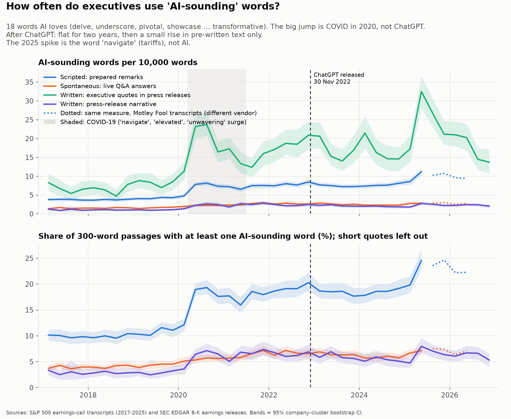
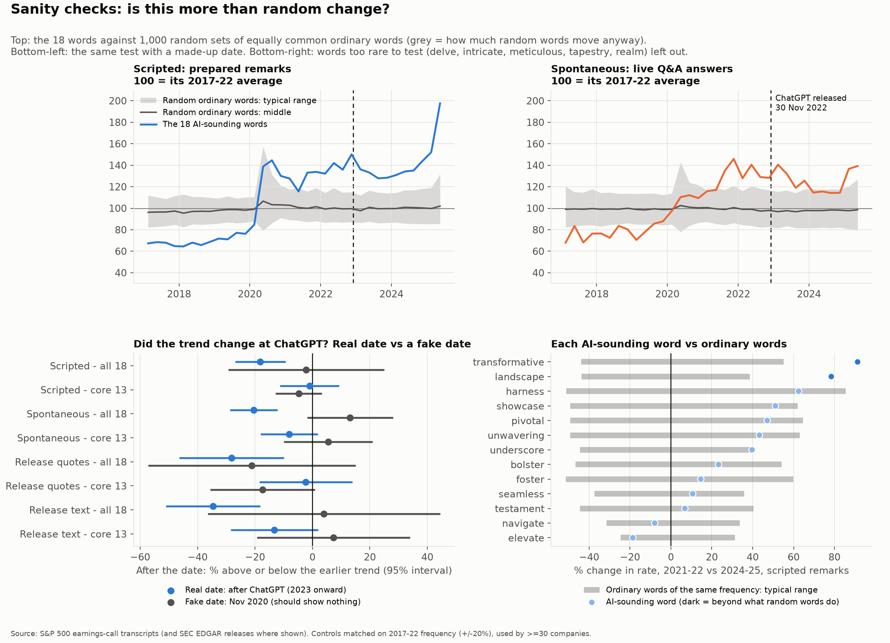
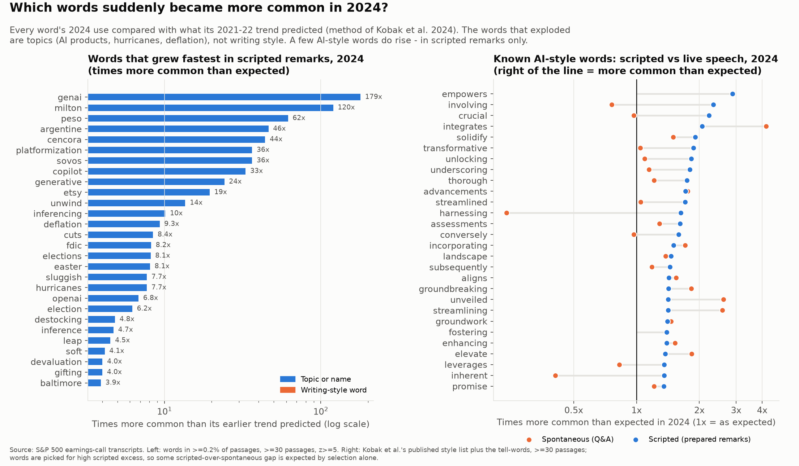
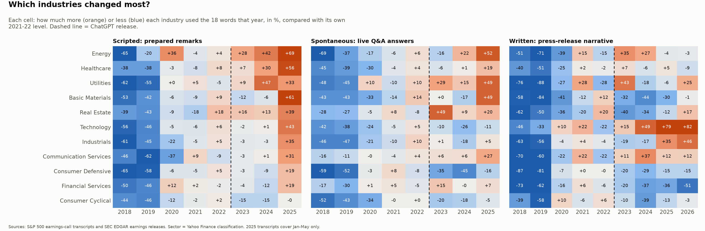

# Are executives letting ChatGPT write for them?

I checked 163 million words from the bosses of America's 500 biggest companies to see whether they started
sounding like ChatGPT after it launched in November 2022.

**The answer: maybe a little, but there is no proof.**

- Nothing changed when ChatGPT came out.
- From 2024, a few "AI-sounding" words (underscore, transformative, harness...) creep up, but only in text
  written ahead of time: scripted speeches +10%, press-release quotes +17%. When the same executives speak
  live, nothing changes (−6%). That is a real hint.
- The change is small and no bigger than normal drift in business language (about 1 random group of
  ordinary words in 12 moved just as much). A hint, not a smoking gun.
- The moment executive language really changed was COVID in 2020. And nobody says "delve".

**Read more:** [project site](https://yousuf6273.github.io/exec-ai-vocab/) ·
[results in one page](results.md) · [full method](methodology.md)

## The idea in three steps

1. ChatGPT overuses certain words. Count 18 of them in executive language, 2017 to 2026.
2. On an earnings call, executives **read a script** and then **answer questions live**. AI can write the
   script, not the live answer. Compare the two.
3. Check the result against random ordinary words, a fake launch date, and every other word in the corpus.

## Data

| Series | Source | Period | What it is |
|---|---|---|---|
| scripted | S&P 500 earnings calls, Hugging Face `zcyeee/sp500-earnings-call-turns` | 2017 - May 2025 | executives' prepared remarks |
| spontaneous | same calls | 2017 - May 2025 | the same executives answering analysts live (control) |
| written_quote / written_body | SEC EDGAR 8-K item 2.02, exhibit 99.1 | 2017 - Nov 2026 | earnings press releases: executive quotes / narrative |
| scripted_ext / spontaneous_ext | Motley Fool transcripts, Hugging Face `Rogersurf/earnings-call-transcripts` | 2024 - May 2026 | caveated extension, never spliced into the main series |

All sources are free and need no account or key. SEC requests carry a contact User-Agent and stay under
SEC's 10 requests/second limit.

### What is in `data/`

| File | Contents |
|---|---|
| `corpus_documents.csv` | **The cleaned corpus, one row per document**: company, ticker, CIK, sector, size (public float and size third), HQ state and region, date, quarter, speaker role, text type (scripted / spontaneous / written), word count, and the count of each of the 18 tell-word families. |
| `corpus_text_press_releases.csv.gz` | Cleaned text of the SEC press-release documents (public filings). |
| `yearly_passage_counts.csv.gz` | For every word: number of 300-word passages containing it, by series and year (the input to the excess-vocabulary analysis). |
| `universe.csv`, `edgar_company_meta.csv` | Company list and SEC metadata. |

Earnings-call transcript text is third-party copyrighted material, so it is **not** redistributed here.
Running the pipeline rebuilds the full cleaned text locally as `data/corpus_text.csv.gz` (git-ignored).

## Reproduce

```bash
python3.12 -m venv .venv
.venv/bin/pip install -r requirements.txt
./run_all.sh
```

Needs about 6 GB of disk and roughly two hours, most of it the rate-limited SEC download. Everything is
cached under `cache/`, so re-runs only repeat the analysis. Before fetching from SEC, put your own contact
address in `SEC_UA` in `src/config.py`.

| Script | Step |
|---|---|
| `src/config.py` | word lists, break dates, windows: all analysis settings in one place |
| `src/fetch_transcripts.py`, `src/build_universe.py`, `src/fetch_edgar.py` | fetch |
| `src/clean_transcripts.py`, `src/clean_edgar.py`, `src/features.py` | clean, strip boilerplate, tokenise, count |
| `src/analyse.py` | all statistics, written to `results/*.csv` and `results/summary.json` |
| `src/charts.py` | `charts/*.png` |

## Charts

| | |
|---|---|
|  |  |
|  |  |
|  |  |

The company leaderboard (`charts/company_vocabulary_shift.png`, `results/company_vocabulary_shift.csv`)
ranks **vocabulary shift only**. A high rank is not evidence that a company used AI.

## For the technically minded

Segmented (interrupted time-series) regression with Newey-West errors and a company fixed-effects panel;
difference-in-differences between scripted and spontaneous speech on the same calls; 1,000 draws of
frequency-matched control words; a placebo break date; company-cluster bootstrap intervals; and the
excess-vocabulary method of Kobak, González-Márquez, Horvát and Lause (2024, arXiv:2406.07016).
Details and every judgement call are in [methodology.md](methodology.md).

Built end to end by an AI coding agent (Claude).
