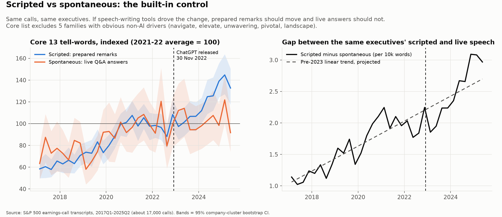
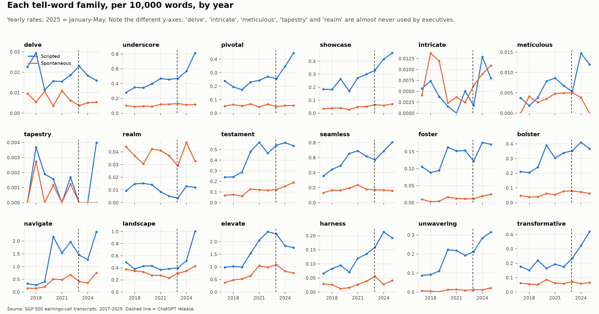

# Are executives letting ChatGPT write for them?

A measurement of whether "AI-style" vocabulary (delve, underscore, pivotal, transformative...) spiked in what
senior executives say and publish after ChatGPT's release on 30 November 2022.

- **Findings (one page):** [results.md](results.md)
- **How it was done, and every judgement call:** [methodology.md](methodology.md)
- **Project site:** https://yousuf6273.github.io/exec-ai-vocab/

**Short answer.** There is no jump at the ChatGPT date. Tell-word use does drift upward in 2024-25 in
text that is drafted in advance (prepared remarks +10%, executive quotes in press releases +17%) but not
in live Q&A answers from the same people (-6%) or in press-release narrative (-9%). That is the pattern
AI-assisted drafting would produce, but the effect is small, is carried by a handful of words
(transformative, landscape, underscore, harness), and is not statistically separable from ordinary
vocabulary drift (p = 0.08 against matched control words). "Delve" never appears. The largest vocabulary
shock in the period is COVID-19 (2020), not ChatGPT.

## Data

| Series | Source | Period | What it is |
|---|---|---|---|
| scripted | S&P 500 earnings calls, Hugging Face `zcyeee/sp500-earnings-call-turns` | 2017 - May 2025 | executives' prepared remarks |
| spontaneous | same calls | 2017 - May 2025 | the same executives answering analysts live (control) |
| written_quote / written_body | SEC EDGAR 8-K item 2.02, exhibit 99.1 | 2017 - Nov 2026 | earnings press releases: executive quotes / narrative |
| scripted_ext / spontaneous_ext | Motley Fool transcripts, Hugging Face `Rogersurf/earnings-call-transcripts` | 2024 - May 2026 | caveated extension, never spliced into the main series |

All sources are free and need no account or key. SEC requests carry a contact User-Agent and stay under
SEC's 10 requests/second limit.

### What is in `data/`

| File | Contents |
|---|---|
| `corpus_documents.csv` | **The cleaned corpus, one row per document**: company, ticker, CIK, sector, size (public float and size third), HQ state and region, date, quarter, speaker role, text type (scripted / spontaneous / written), word count, and the count of each of the 18 tell-word families. |
| `corpus_text_press_releases.csv.gz` | Cleaned text of the SEC press-release documents (public filings). |
| `yearly_passage_counts.csv.gz` | For every word: number of 300-word passages containing it, by series and year (the input to the excess-vocabulary analysis). |
| `universe.csv`, `edgar_company_meta.csv` | Company list and SEC metadata. |

Earnings-call transcript text is third-party copyrighted material, so it is **not** redistributed here.
Running the pipeline rebuilds the full cleaned text locally as `data/corpus_text.csv.gz` (git-ignored).

## Reproduce

```bash
python3.12 -m venv .venv
.venv/bin/pip install -r requirements.txt
./run_all.sh
```

Needs about 6 GB of disk and roughly two hours, most of it the rate-limited SEC download. Everything is
cached under `cache/`, so re-runs only repeat the analysis. Before fetching from SEC, put your own contact
address in `SEC_UA` in `src/config.py`.

| Script | Step |
|---|---|
| `src/config.py` | word lists, break dates, windows: all analysis settings in one place |
| `src/fetch_transcripts.py`, `src/build_universe.py`, `src/fetch_edgar.py` | fetch |
| `src/clean_transcripts.py`, `src/clean_edgar.py`, `src/features.py` | clean, strip boilerplate, tokenise, count |
| `src/analyse.py` | all statistics, written to `results/*.csv` and `results/summary.json` |
| `src/charts.py` | `charts/*.png` |

## Charts

| | |
|---|---|
|  |  |
|  |  |
|  |  |

The company leaderboard (`charts/company_vocabulary_shift.png`, `results/company_vocabulary_shift.csv`)
ranks **vocabulary shift only**. A high rank is not evidence that a company used AI.

## Method reference

Kobak, González-Márquez, Horvát, Lause (2024), *Delving into LLM-assisted writing in biomedical publications
through excess vocabulary*, arXiv:2406.07016.

Built autonomously by an AI coding agent (Claude); see `methodology.md` for what that means for how to
read the results.
